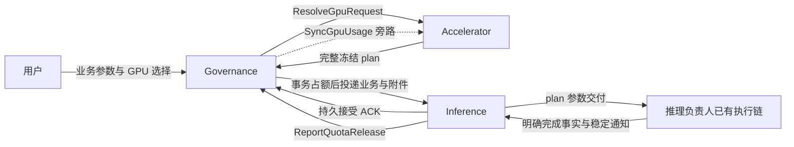

# Gov / Acc / Inference v1.2 创建与退额接线计划

批次：`GOV-ACC-INF-V12-WIRING-01`。编制日期：2026-10-09（Asia/Shanghai）。

状态：计划已形成，实施、生成、测试、提交、推送和部署均未启动。

配套执行提示词：[完整 Goal](governance-accelerator-inference-v1.2-goal.md)。本计划与 Goal 文本的落盘不等于启动实施或发布。

## 1. 用户确认的目标与责任

完整业务主链是：用户经 Gov 提交推理业务和 GPU 选择；Gov 调 Acc 获取冻结计划并一次占额；Gov 可靠投递；Inference 持久接受业务、plan、原 charges 并正确交付参数；推理负责人继续执行工作负载、模型运行和清理；Inference 在负责人判定可退额后调用 Gov；Gov 幂等退额并异步同步 Acc 使用关联。

**本批交付其中的创建接线、参数接收与持久化、退额双向接线和负责人交接文档。**本批不实现或验收模型推理、实际 GPU 调度、完整清理判定、何时发起退额、释放通知 outbox 的业务触发和调度。退额客户端不能只有文档或空接口；必须有真实 gRPC 实现、配置、装配和受控调用验证。

本批可观察结果：

1. 真实 Gov 业务入口调用既有受理能力，经过真实 Acc 合同取得 plan、真实 PG 占额和真实 Inference gRPC 受理；两边的资源/命令身份、业务正文、plan、GPU charges 一致，重试不重复占额或建立第二个实例。
2. Inference 从收到的 plan 正确取得模式、型号键、每设备显存、核心限制比例、单位编码、总量和 runtime 片段；通过真实参数转换/渲染函数验证其交付，不启动工作负载或模型来代替参数断言。
3. 对在隔离测试中显式注入的“负责人已经确认完成”的通知，Inference 真实退额客户端经 mTLS 调用 Gov；Gov 只退原 charge 的一次累计差额。该结果仅证明接线及协议，不能写成真实删除已经完成。

用户最新裁定覆盖早期“整个推理生命周期由本批完成”和“退额仅写文档”的范围。缺少模型/GPU 不阻塞本批软件接线完成；缺少可信身份、正式契约或必需依赖不能以绕过方式完成。

## 2. 已核对的源码基线

以下是规划时的不可变证据，不假定后续执行时移动分支仍停在这些提交。R0 必须核对远端 main 与相关差异，选择并记录执行基线。

| 仓库 | 规划核对提交 | 核对范围 |
|---|---|---|
| Accelerator | `1d32dd9a9173b8869fa0ef2ae64e20b88f2ca0a3` | 本地 main；已发布的 Acc 模块及活跃合同 |
| Inference | `01033dbbca64164e7a1ae52516a4b731e5858e66` | 本地 main；创建接口、plan、PG、runner 和 KServe 参数投影 |
| Governance | `25a171cc676e8dc5f2a614da08f64c0dc5daff06` | 已在线确认远端 main；不是当前旧工作区分支 |

规划时 Gov 工作区为 `refactor/quota-contract-convergence`，HEAD `d1a804f1d35d7294cb7eab48ee3f256d9d2482b5`，有无关 `_agent/`。本地 main 为 `4d05e34f89007002ab8d6473ca3d7a6becb6aaa4`，缓存 origin/main 为 `315389d274acfc4237a87b9b4c98c23320f91b4c`；均不能直接当作上述远端 main。不得切换、覆盖或清理该旧工作区来实施。

已发布 Acc 版本：`v0.0.0-20260924030150-1d32dd9a9173`，Gov 和 Inference 目前均消费该版本。

### 2.1 已有代码，直接复用

- Gov `api/protos/admin/service/v1/i_accelerator.proto` 已有 profiles、capacity、admission-preview 等路由，并由正式 REST 装配注册。预检会 Resolve、Fit 和读额度，不占额。
- Gov `app/admin/service/internal/service/gpu_acceptance.go` 已有 `AcceptGpuCreate` / `AcceptGpuDelete`，包含授权、历史重放、Resolve、完整 canonical、全量 quota items 和占额。
- Gov `app/admin/service/internal/data/quota_ledger_repo.go` 当前为 **Ent 事务实现**，已有 Occupy、原子未发撤销、持久 DELETE、累计 Release 和 receipt。不得照抄旧计划把这次接线扩大为 pgx/sqlc 数据层重写。
- Gov 已有 `BuildGpuOwnerAttachments`、严格 ACK 校验、dispatch worker、usage sync worker、`ReportQuotaRelease` receiver；仍缺正式 Inference binding/业务 BFF，退额 `CertOwnerMap` 仍为空。
- Inference 已有 `ResourceSpec.gpu`、完整 `gpu.Plan`、计划校验、PG 快照和 KServe 参数投影。当前创建自行生成 ID，返回后后台调用 Acc Resolve；没有 Gov owner 附件和原 charge 合同。
- Inference 旧通用 reservation port 未在正式 runner 装配。不能把旧 Reserve/Confirm/Release 代码写成已经接通 Gov；也不能把新的 GPU refund reporter 塞入 stop/restart 的旧退额步骤。
- Acc 的 Resolve 调用者已限制为 Gov；Sync 只收 Gov，ObserveRelease 只收对应 Inference owner。保留这些权限。

### 2.2 原始主链断点

1. Gov 缺真实推理创建/删除 BFF 和编译注册的 Inference adapter。
2. Inference 创建协议缺完整可信附件、明确 durable ACK、原 Gov 身份/charges 的事务持久化。
3. 新受管 GPU 实例仍可能进入后台自行 Resolve 或旧 reservation 路径。
4. Inference 缺实际 Gov 退额客户端；Gov 缺正式 Inference 退额身份装配。
5. Gov 退额生成包属于根模块 `go-wind-admin`，当前不能直接作为 Inference 的正式远程 Go 依赖。

## 3. 目标接线与信任来源



- 用户只提交业务内容和 GPU 选择，不提交可信 tenant/actor/owner、plan、charges 或下游地址。
- Gov 从 Principal、持久资源租户 UUID 映射、账本和注册 adapter 派生可信上下文；数字租户 ID 不能直接转字符串充当资源 UUID。
- Inference 验证直接 Gov 服务身份，以及附件和业务正文的一致性；metadata 自报、计划摘要或同 CA 证书均不能独立提供授权。
- 新 GPU 创建只走受管命令；缺附件、缺 plan、未登记 owner、非法摘要或额度不足须失败关闭。
- GPU 使用关联不是占额前置，不建立 RegisterConsumer/MarkClosing/Finalize/TCC 或第二套 dispatch。

## 4. 接口与持久化决策

### 4.1 唯一公共契约与依赖顺序

复用 Acc 已发布的 `accelerator.v1.ResolvedGpuPlan`、`accelerator.integration.v1.GpuOwnerCreateAttachment`、`GpuOwnerDeleteAttachment` 和 `DurableOwnerAck`。不在 Inference/Gov 再定义同名 plan 或附件。

Gov 退额协议的唯一源仍是 `api/protos/quota/service/v1/quota_release.proto`。新增 **仅含该退额协议生成代码的公开 API 子模块**，拟定路径和 module：

```text
ani-governance/api/quota/go.mod
module github.com/zhangzhe-ctrl/ani-governance/api/quota
ani-governance/api/quota/gen/go/quota/service/v1/
```

保持 wire package `quota.service.v1`、RPC 全名、枚举值和所有字段 tag；Gov 根 module `go-wind-admin` 保持原名。通过受管生成配置迁移到公开子模块；最终 Gov 和 Inference 都消费该发布版本，旧 Release 生成包退出依赖图，避免同一个 descriptor 重复注册。不得复制手写 Proto/生成包、导入兄弟仓库 internal，或新增共享业务 runtime。

依赖发布顺序：

1. Gov quota API 子模块局部生成和验证，形成可发布提交，通过任务分支发布；使用其实际 pseudo-version，不需要创建 tag。
2. Gov receiver 改用该包；Inference 锁该包和既有 Acc 包，完成自己的公开协议、接收和退额客户端。
3. 发布 Inference 的真实新接口模块版本。
4. Gov 正式 adapter 锁定该 Inference 版本，再完成最终三仓交付验证。
5. Acc 如果仅补文档/合同用例，继续消费既有接口版本；只有实际接口增量时才先发布 Acc 新版本并由两侧统一锁定。

依赖图为 `Gov runtime → Inference API → Gov quota API`，不是两个根 runtime 循环。所有最终消费者使用 `GOWORK=off` 和已发布版本；禁止本地 replace 或复制包冒充跨仓交付。

### 4.2 创建请求和 ACK

- 沿用 `InferenceServiceManager/CreateInferenceService` 和原业务字段；增加受管 GPU 附件，具体字段/tag 在 R1 冻结，不更换既有字段 tag。
- 公共 Gov BFF DTO 不暴露内部附件。adapter 从既有 canonical 和原 charges 生成附件。
- 规范业务摘要覆盖不含附件和即时派生 ID 的业务正文；两边使用同一转换及固定测试向量，避免摘要自包含循环。
- `resource.gpu` 与 `gpu_plan.request`、外层副本/拓扑、目标容器必须一致；不能存在两套数量来源。GPU 附件为原 GPU 子集，混合业务原全量 charges 通过显式业务合同保留，不能丢失非 GPU 项。
- `OperationResponse` 增加明确 `DurableOwnerAck`；Gov adapter 核验接收的命令 ID、资源 ID、accepted，并映射成既有 worker 要求的三个 snake_case 字段。
- Gov 创建 ref 的 `resource_id` 和 `create_operation_id` 成为受管实例及原创建命令身份，不能另造无关联 ID。后续本地 operation/generation 不替换原退额引用。
- 命令身份、规范业务正文、完整 plan、原 charges、计量版本、执行意图和 ACK 在同一 PG 事务保存后才返回；同 ID 同内容重放原 ACK，异内容冲突、无副作用。

### 4.3 删除命令接线

Gov 删除 BFF 调已有 `AcceptGpuDelete`，保留未发撤销与已发 DELETE 的区别。Inference 使用专用删除请求携带公共 delete 附件，既有 request/resource/generation 字段 tag 保留。

本批完成删除命令的真实接收、可信原 CREATE/plan/charges 保存及 durable ACK；支持没有本地实例时保存 DELETE 接收/关闭意图，不能因未知本地 generation 返回假完成。已存在明确关闭意图时，迟到 CREATE 不得安排新的执行意图。

实际关闭执行点、K8s 在途写核清、全部历史 Pod 清理、ObserveRelease、关闭完成事实与 outbox 触发属于推理负责人工作。不得把本批 DELETE ACK 或关闭意图写成真实资源已释放。

### 4.4 冻结计划的参数交付

在受管创建事务保存完整 plan；后台复验并复用，缺 plan 拒绝。新受管 GPU 路径不调用 Acc Resolve，也不申请第二次 reservation。

至少断言以下参数保存和交付一致：

| 类别 | 字段或意义 |
|---|---|
| 规格 | profile/version、mode、model_key、isolation_class |
| 每设备限制 | shared_memory_mib、core_limit_percent；后者为比例，不是 CUDA 核数 |
| 编码 | memory_block_mib、memory_blocks_per_device、memory_percentage |
| 总量 | logical/exclusive_device_count、全部副本 shared_memory_mib |
| 运行片段 | scheduler、queue、node labels、annotations、limits、runtime class、recipe |
| 身份/摘要 | 原 ref、baseline/resolution/business digest、全部原 GPU charges |

首期 devices_per_replica=1，总 GPU Pod 数不超过现合同上限 16。Deployment 的 GPU replicas 等于业务 replicas，容器为 kserve-container；LWS 等于 groups×(leader+workers)，容器为 main。

复用真实 KServe 参数投影函数验证最终 selector/annotations/limits，避免只比较存储 JSON。queue_name 当前仅保存，必须核对它通过受管 annotations/既有 PodGroup 合同正确交付；不得声称保存字段就已完成调度接线。不能修改引擎 command/args 或替负责人推导模型参数。

### 4.5 退额接口接线与调用责任

Inference biz 提供小而明确的退额端口，data 实现 Gov gRPC adapter，composition root 装配；端口接收负责人已经持久保存的通知，不自行判定是否释放，不创建公开退额 HTTP 后门。

| 请求字段 | 要求 |
|---|---|
| release_event_id | 调用方保存的稳定逻辑事件 ID；重试不重新生成 |
| operation_id | 原 CREATE ID，不是 DELETE/restart/update ID |
| items | 原 charge_id/quota_code，累计 released_total；GPU 必须原子上报完整原 GPU 子集全量 |
| reason | RESOURCE_RELEASED 或 ABORTED_CLEANED；不替代真实清理事实 |
| resource_refs | 仅审计，不提供授权或释放证明 |

客户端校验通知与已保存原上下文一致，使用受管地址、TLS 1.3、CA/证书/key/目标名称、固定超时，传播稳定错误，核对完整响应。失败或丢响应重试同一个已持久通知的约定写入交接文档；本批不实现业务 outbox 的创建时机/调度，也不在内存临时生成事件作为可靠通知替代。

Gov 保留现有独立 mTLS receiver：由客户端精确 DNS SAN 映射 ani-inference，tenant/resource 从原账本确定。注册映射和 listener 配置必须真实装配；不能仅删除 CertOwnerMap=nil 或接受任意同 CA/环境 owner 字符串。

测试通知必须先有 Gov 持久 DELETE 关联，显式标为注入的完成事实。正常 stop/start/restart/update、失败、超时、CR NotFound 和部分清理均不能自动调用新增 reporter。旧 reservation 不承担 Gov GPU charge。

## 5. 三仓修改范围与所有权

| 仓库 | 允许的直接相关修改 | 实施重点 |
|---|---|---|
| Gov | api/protos 的推理 BFF/退额源/必要 identity enum；拟新增 api/quota；受管 buf 配置；api/gen/go 定向生成；app/admin/service/internal/{service,data,server} 的具体接线；app/admin/service/cmd/server/wiring_ent.go；权限/模块数据脚本；go.mod/sum；定向 tests 和 contracts | 真实创建/删除入口、Inference binding/client、严格 ACK、公开退额契约、owner 身份装配 |
| Inference | api/inference/v1；受管生成入口/buf；internal/service、internal/biz/{inference,gpu}；internal/data/{postgres,governance,kubernetes} 的持久化/退额/必要参数投影；cmd；queries、显式 migrations、sqlc 输入；go.mod/sum；定向 tests 和 docs | 接受原 ID/plan/charges、事务 ACK、受管参数交付、退额客户端与装配 |
| Acc | docs/contracts、docs/plans、必要 contract/auth tests；有真实互操作缺陷时最小修复对应 service/data/server/API 路径 | 维护单一 plan/附件合同、声明调用方向和负责人交接；不为制造三仓代码量而修改 runtime |

必须保持 Gov 当前 Ent 数据层、Acc pgx/sqlc 和 Inference pgx/sqlc 各自现状；不迁移启动、不泛化 framework、不升级无关依赖、不改 Model/Resource/IAM/Installer 等第四仓、不改来源设计快照或历史 PASS。

推理模块/action/权限/套餐关系必须按权威登记落地。当前 Gov enum 无 INFERENCE；不能直接使用 ACCELERATOR 读权限放行推理创建，也不能编造全局编号。找不到登记权威时阻塞这部分启用，继续接口和隔离软件验证，并提出一次明确的编号/权限输入需求。

真实部署地址、证书 SAN、CA/key、actor/action/tenant/cluster grant 和生产签名密钥不从本文推导。隔离测试允许任务专有 CA 与合同身份；生产资料缺失标记 not_verified，不增加 skipVerify 或 test owner 生产配置。

## 6. 执行批次、依赖和证据

| 阶段 | 工作 | 可审查/可运行输出 |
|---|---|---|
| R0 | 核实三仓 main/dirty/remotes，保护旧 Gov 分支；建任务 worktree、Fedora 独占资源；冻结权限/业务摘要/生成入口和公开依赖路线 | 三仓 base/head/manifest、已登记身份与待登记项、可恢复资源位置；尚无业务 PASS |
| R1 | 先发布退额 API 子模块；冻结 Inference 新创建/删除/ACK；定向生成；验证 wire tag、兼容导入和无重复 descriptor | 已发布可消费契约版本，真实生成 Go 消息/客户端；非空原 plan/charge 向量 |
| R2 | 优先打通一副本共享创建接线：Gov BFF/既有占额/adapter→真实 Inference 接受与事务保存→真实参数投影；只在外部 provider/模型/K8s 接口处使用明确替身或暂停 | PG 账户/operation/charge 与 Inference ref/plan/ACK 参数一致；创建重放不双扣；没有新受管 Resolve |
| R3 | 删除接收和退额双向 wiring；显式注入完成通知，经实际 mTLS 调现有 Gov Release；程序集成而非复制 owner fixture | 通知一次退额、重放零增量、身份/原 CREATE/全量向量负向无余额变化；不证明实际删除 |
| R4 | 覆盖整卡、固定副本/LWS 参数、摘要/权限/重放/重启恢复和误触发防护；版本发布顺序闭合 | 下述必验矩阵通过、最终 consumer 只用固定发布版本 |
| R5 | 更新交接合同和本批结果；定向门禁、必要跨模块门禁、分支发布、资源清理和最终回执 | 三仓候选/发布 SHA、模块版本对、测试结果、证据位置、负责人待办及 not_verified 边界 |

R2、R3 是同一接线交付的两个验证面，必须都完成；不能只交孤立 Proto 或只证明接口注册。R1 完成后主体受理和退额客户端可按文件所有权并行，Gov 最终 adapter 待 Inference 版本发布后锁定。

### 6.1 必验矩阵

| ID | 行为 | 本批证据 |
|---|---|---|
| C01 | 真实 Gov BFF→已有 Resolve/Occupy→真实 Inference RPC | 服务进程或真实服务装配、PG 前后断言、完整消息与 ACK |
| C02 | 共享与整卡、Deployment/LWS、固定副本参数 | 每设备/总量、编码、selector/注解/limits 与冻结 plan 一致 |
| C03 | 同 key/命令并发与 ACK 丢失重放 | 单 operation/资源、单 charge 向量、原 ACK、不重 Resolve |
| C04 | 跨租户/错 caller/伪造附件/错摘要/错误 charge/额度不足 | 在对应入口拒绝且无新增实例、占额或执行副作用；权限先于幂等读取；不得把 Gov 已占额度从 Inference 私自撤销 |
| C05 | Inference 重启和 Gov 重投 | 原 ref/plan/charges/ACK 从 PG 恢复，不改原身份 |
| C06 | DELETE 受理、未发撤销与 DELETE 先到 | Gov 持久原关联，Inference 接收原上下文，不返回假释放 |
| Q01 | 真实 Inference refund client→真实 Gov mTLS receiver/PG | 先有持久 DELETE；显式注入通知，仅原 charge 退一次 |
| Q02 | 回应丢失及重复/乱序累计通知 | 原 event/报文重试、delta 正确、无双退；不实现通知触发器 |
| Q03 | 错 DNS owner/CA、错原 CREATE、漏 GPU 项、部分/超量、同事件异内容、无 DELETE | 真实 receiver 拒绝且余额、charge、receipt 不非法变化 |
| Q04 | stop/start/restart/update/异常不会误调 reporter | 受管实例不走旧 GPU reservation、无自动 GPU refund |
| A01 | Sync 旁路与 Acc 身份方向 | 既有合同回归：Gov Resolve/Sync；Inference Observe；ENDED 不清 live Binding |
| D01 | 公开契约与发布版本 | GOWORK=off、无 replace、无 root runtime 循环/重复 descriptor、version/sum/生成可重现 |
| H01 | 负责人交接完整 | 真实报文字段/单位/身份/错误/重试/待实现职责及完整实例示例 |

场景复用现有设施；不反复重跑未变化的全仓门禁。先受影响行为测试；跨 API/装配/数据库影响使本批需要一次最终交付门禁。失败修复只重跑相关项及被影响的必需门禁。

## 7. 执行环境、生成和 Git 发布

本地只用于阅读、编辑、Git 和传输。依赖获取、格式化、生成、构建、静态检查、测试、PG/证书/进程/容器及 API 驱动全部在已有授权 Fedora 主机；失败不退回本地。

任务使用独占目录、PG/角色、端口、缓存、TMPDIR、证书及仓外日志，GOWORK=off，建议 GOMAXPROCS=2、GOFLAGS=-p=2；先核对现有远端重任务锁，不并发争抢共享资源。无需访问生产集群或安装 GPU/Volcano/HAMi。

- Acc：活跃源在 api/protos，使用 make api；触及 runtime/API 时跑相应定向测试及 make verify，提交前遵守本仓门禁。文档-only 不自动触发全量软件验收。
- Gov：遵守其 main AGENTS 和实际 Makefile/工具锁；使用受管 make api/生成模板，不能裸 Buf 生成后删除无关输出；本批跨 API/装配影响按当前正式 verify-ci 门禁执行。
- Inference：规划基线没有 Makefile/scripts/.github；现有 buf.gen.yaml 只生成消息，buf.model.gen.yaml 有 Go/gRPC。先建立一个本任务需要的固定、可重现生成入口，明确 Acc 上游 Proto 输入和 Go/gRPC 输出范围，不能假称已有 make api。沿用核实的 Buf/插件锁，不自动升级。
- Inference PG 测试使用 INFERENCE_PG_DSN 和现有 lifecycleDatabase；显式迁移后运行，缺 DSN 导致 skip 不算 PASS。SQL 改动通过其 sqlc.yaml 生成，生成代码不手改。
- 基础候选命令以实际入口为准：Inference 受影响包 go test -p 1 -count=1、新退额 adapter 包、真实 PG/进程合同测试；最终 go vet/go build 与必要相关 race。没有本批集群/envtest诉求，不为了 full go test 误启动未授权集群实验。

实施 Goal 明确允许任务分支源码提交与非强制推送，以满足上述公共模块正式消费；分支用 codex/ 前缀，保护主分支及无关状态。只向各仓已经核实的对应 remote 发布，不创建新仓库、tag、PR 或合并 main，不推镜像/部署。依赖发布使用实际 pseudo-version；缺发布授权或 remote 时不得用 replace 伪装完成。

每次发布前验证对应候选；最终记录 provider SHA→模块版本/sum→consumer SHA 的版本对。规划文件未提交时，在实施 worktree中携带这两个任务文档，不因建立 worktree丢失任务依据。

## 8. 交接文档与完成边界

Acc 的 docs/contracts 作为三方合同导航；Gov 的既有 gpu-owner-integration-guide 更新为最终真实接线；Inference 的交接文档解释其真实字段、保存位置、配置和 callable refund port。只维护一套权威合同及引用，不复制三份漂移的状态总结。

给推理负责人至少提供：

1. 创建/删除的完整业务消息和附件、资源租户映射、ID/摘要/ACK 规则。
2. 整卡和共享例子；共享例子每 Pod 6144 MiB、F=1024、q=6，两 Pod 总额12288 MiB；整卡每 Pod 1张、cores=100、memory_percentage=100且共享计量=0。示例 ID/证据明确为示意。
3. 参数从 proto→biz→PG→runtime 的映射；queue 的实际交付合同。
4. 可调用退额端口、真实配置项、证书规则、原通知字段、响应核验和错误/重试约定。
5. 负责人必须补齐：真实模型运行、可信 Pod 签名及完整历史范围、创建封闭/在途写/清理、ObserveRelease、关闭完成与持久 outbox、退额触发、恢复与真实 GPU验收。
6. “止于接线”的受控注入事实证据与真正业务完成证据分别记录；不能根据接口已接线打开未经验证的正式供给或宣布生产已可用。

交付仅保留本计划、Goal、最终接线/负责人交接合同和一个本批结果索引；原始日志在仓外。用 pass/fail/not_verified 标明源码、软件接线、依赖发布、CI、部署和真实 owner/GPU。最终范围内代码与必验项全部完成才算本批 achieved；负责人后续职责明确 not_verified，不自动启动下一批。

## 9. 恢复与阻塞处理

不 reset/clean/stash/强推或覆盖其他人的树；只清理本任务明确拥有的远端资源。迁移为版本化增量，保留恢复点，不在启动执行 DDL，也不把旧 direct GPU 实例补造成 Gov charge。

基线有无关新增提交时核对相关路径并记录新基线即可；合同/主体归属发生冲突、必须改第四仓或共享环境时停止该依赖步骤并说明真实冲突。生产地址/证书/硬件缺失不阻止隔离软件接线；正式模块编号或发布权限缺失不伪造，继续独立工作，最后给出具体待输入项。

不要通过扩大审计、重读全部历史或重复跑已通过检查拖延主体接线。每轮应打通一个可运行行为、解除具体阻塞或取得决定下一步的真实证据。
